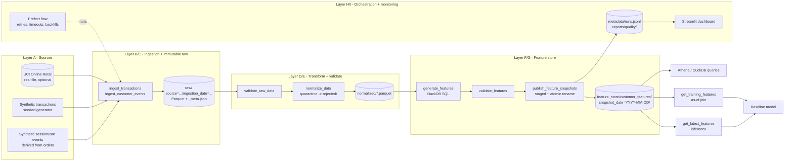
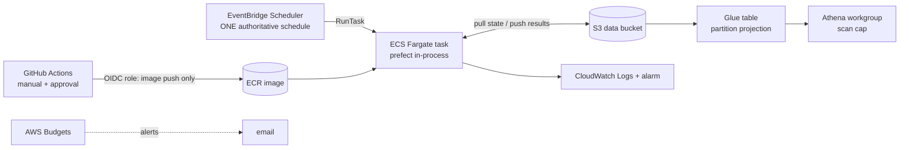

# Architecture

## Logical layers



## AWS deployment (prepared, not deployed)



## Module boundaries

| Package | Responsibility | Knows about |
|---|---|---|
| `config` | typed settings, path layout | nothing else |
| `ingestion` | sources, incremental raw writes, download | `config`, `utils` |
| `processing` | cleaning / normalization / quarantine | `ingestion` schemas |
| `features` | registry, SQL, DuckDB engine, consistency checks | `config` |
| `validation` | check library + stage suites, report model | `features`, `ingestion` schemas |
| `storage` | feature store (Parquet), S3 state sync | `features` |
| `orchestration` | steps, single-run pipeline, Prefect flows, locks, maintenance | everything above |
| `monitoring` | run registry, error taxonomy | - |
| `ml` | downstream demo | `storage` |

Business logic (steps, SQL, validation) is independent of the executor: the same
`run_snapshot` sequence runs under Prefect (steps wrapped as tasks) or as plain Python.

## Data layout under `FF_DATA_ROOT`

```
raw/source=transactions/ingestion_date=2025-03-01/{part-0.parquet,_meta.json}   immutable deltas
raw/source=customer_events/ingestion_date=.../
normalized/{transactions,customer_events}.parquet                               cleaned, versioned
rejected/{transactions,customer_events}.parquet                                 quarantine + reason
feature_store/customer_features/snapshot_date=YYYY-MM-DD/{part-0.parquet,_metadata.json}
staging/                                                                        scratch (not synced)
metadata/{runs.jsonl,latest.json,locks/}
reports/quality/snapshot_date=.../{<run_id>.json,.md,latest.*}   reports/ml/ml_report.json
```

## Key decisions (ADR summary)

| Decision | Why | Alternatives considered |
|---|---|---|
| DuckDB for feature SQL, Polars for cleaning/orchestration glue | SQL is the clearest way to express windowed aggregations; DuckDB scans Parquet lazily and can spill to disk | Pandas (memory-bound), Spark (unjustified infrastructure at this size) |
| One SQL file for *all* features | Prevents training/inference drift: both paths read the same published snapshots | Per-feature functions in several modules |
| Snapshot per date, one Parquet file per partition | The dominant query is "as of date"; avoids small-file explosion; trivial atomic replace | Per-entity partitions (millions of files) |
| Bitemporal records (`event_time`, `available_at`, versions) | Makes late data and corrections correct and testable | Overwriting in place (loses history, leaks) |
| Batch id = hash(date, transformation version, eligible-input fingerprint) | Deterministic idempotency; a correction changes only affected batch ids | Run-id-based dedupe (not idempotent) |
| Prefect in-process inside the container, EventBridge owns the cron | No always-on Prefect server to pay for; exactly one schedule | Prefect Cloud/server + work pool (extra moving parts), both schedulers (double runs) |
| S3 state pull/push around a run | Fargate disk is ephemeral; the pipeline needs the watermark + metadata | EFS (extra cost), DynamoDB state (more infra) |
| Pandera for raw schema, hand-written checks for the rest | Declarative schema is idiomatic; thresholds/severity need custom logic | Great Expectations (heavier) |
